# CBX Shell (`cbxshell-rs`)

Windows Explorer shell extension developed in Rust, providing thumbnail rendering and property info-tips for comic archives, e-books, multimedia videos, audio files, Office/PSD documents, and plain-text/syntax files.

[English Documentation](#english) · [繁體中文說明](#繁體中文說明)

---

<a name="english"></a>
## English

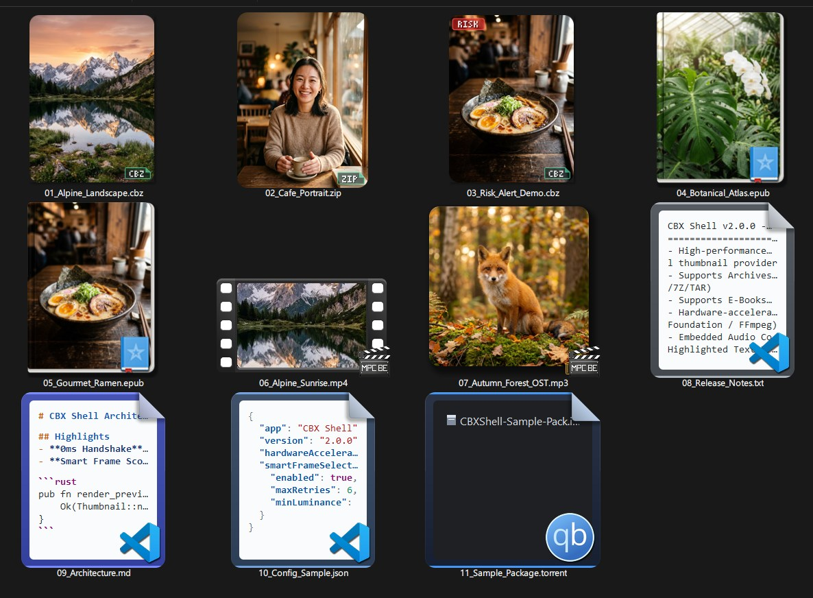

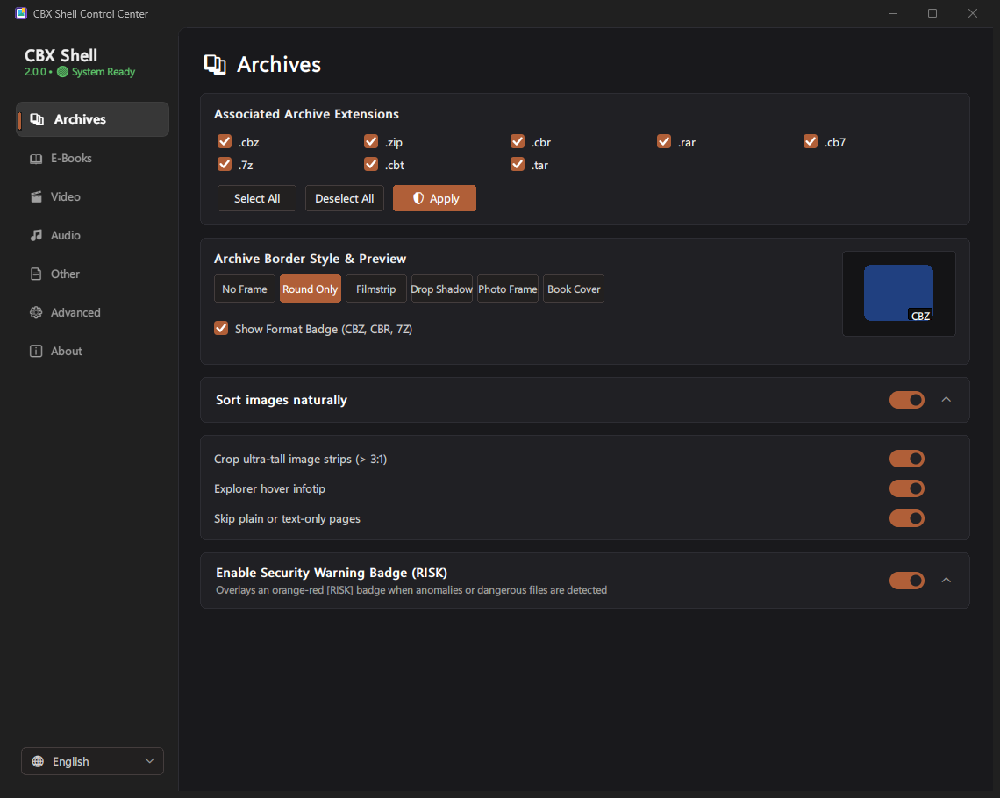

### Technical Documentation (`doc/`)
Detailed implementation guidelines, security specifications, and algorithm metrics are located in the modular `doc/` directory:

- 🏛️ **[System Architecture & Pipeline (`doc/architecture.md`)](./doc/architecture.md)**: Process isolation (`dllhost.exe` COM Surrogate vs in-process), COM RPC anonymous stream probing, Everything IPC lookup, and WMF / FFmpeg fallback pipelines.
- 🛡️ **[Zero-Trust Input Validation & Safeguards (`doc/security.md`)](./doc/security.md)**: Decompression bomb boundaries, granular security risk badges, configuration sanitization, and decoder process isolation.
- 📚 **[Archive & Image Container Support (`doc/archives.md`)](./doc/archives.md)**: ZIP, RAR4/RAR5, 7z, TAR, CJK multi-byte encoding auto-detection (Shift-JIS/Big5/GBK), continuous sequence first-file selection, tall-strip cropping, and 6 border styles.
- 📖 **[E-Book Cover Extraction (`doc/ebooks.md`)](./doc/ebooks.md)**: EPUB, IBA, MOBI, AZW, and optional PDF cover extraction with book cover border styling.
- 🎬 **[Video Frame Evaluation & HDR (`doc/video.md`)](./doc/video.md)**: Seek modes, custom algorithm parameters (`step_probe_sec`, `max_gop_hops`, keyframe probe limits), Rec.601 luminance & Shannon entropy weighted scoring, and HDR ACES tone mapping (enabled by default).
- 📄 **[Documents, Syntax Previews & Companion Tools (`doc/other.md`)](./doc/other.md)**: Office/PSD thumbnails, 20 syntax-colorized text formats, `cbx-manager.exe`, `cbx-installer.exe`, and `cbx-cli.exe`.

### Supported Formats
- **Comic & Image Archives**: `.cbz`, `.zip`, `.cbr`, `.rar`, `.cb7`, `.7z`, `.cbt`, `.tar`
- **E-Books**: `.epub`, `.mobi`, `.iba`, `.azw`, `.pdf` (optional, disabled by default)
- **Encapsulated Images**: `JPEG`, `PNG`, `WebP`, `GIF`, `APNG`, `JPEG XL` (`.jxl`), `QOI`, `BMP`, `ICO`, `TIFF`, `DDS`, `TGA`, `PNM` (`.pbm`/`.pgm`/`.ppm`/`.pam`), `Farbfeld` (`.ff`), `Radiance HDR` (`.hdr`), `OpenEXR` (`.exr`)
- **Video Containers**: `.mp4`, `.m4v`, `.mkv`, `.webm`, `.avi`, `.mov`, `.wmv`, `.flv`, `.ts`, `.m2ts`, `.3gp`, `.ogv`, `.divx`, `.xvid`, `.mpg`, `.mpeg` (H.264 via Media Foundation; HEVC, VP9 and AV1 with the Microsoft Store video extensions; ProRes and other codecs via the optional FFmpeg fallback)
- **Audio Files**: `.mp3`, `.flac`, `.m4a`, `.aac`, `.ogg`, `.opus`, `.wav`, `.wma`, `.ape` (Embedded album art extraction with vinyl disc fallback)
- **Documents, Design & Plain Text**: `.docx`, `.doc`, `.xlsx`, `.xls`, `.psd`, `.txt`, `.md`, `.torrent`, plus 20 optional syntax-highlighted formats (`.json`, `.csv`, `.html`, `.htm`, `.xml`, `.yaml`, `.yml`, `.toml`, `.ini`, `.log`, `.ps1`, `.cmd`, `.bat`, `.sh`, `.sql`, `.py`, `.js`, `.tsx`, `.css`, `.rs`) and custom user-defined text extensions.

### Installation
1. Download `CBXShell-Setup.exe` from Releases (or build it locally via `.\build.ps1`).
2. Run `CBXShell-Setup.exe` to install `cbxshell.dll`, `cbx-manager.exe`, and `cbx-cli.exe`, register the COM thumbnail & info-tip provider, and apply default file extension associations.
3. Restart Windows Explorer (`explorer.exe`) when prompted (or log out and back in) so Windows Shell loads the newly registered extension.
4. Launch **CBX Shell Control Center** (`cbx-manager.exe`) from the Start Menu or install directory to customize file associations, border styles, video decode mode, and cache settings.

### Control Center Settings Pages
| Archives | E-Books |
| :---: | :---: |
|  | 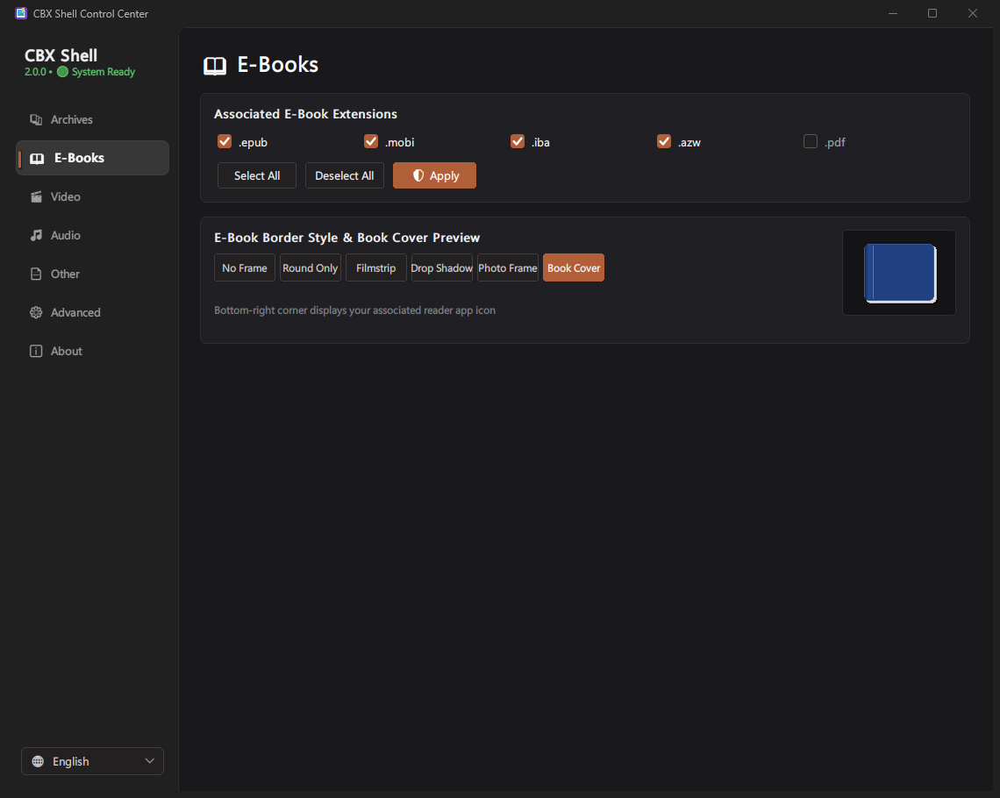 |

| Video | Audio |
| :---: | :---: |
| 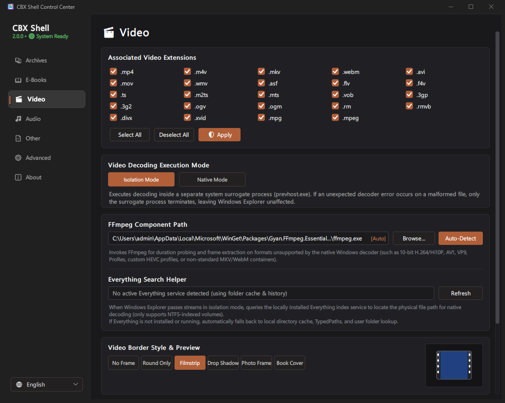 | 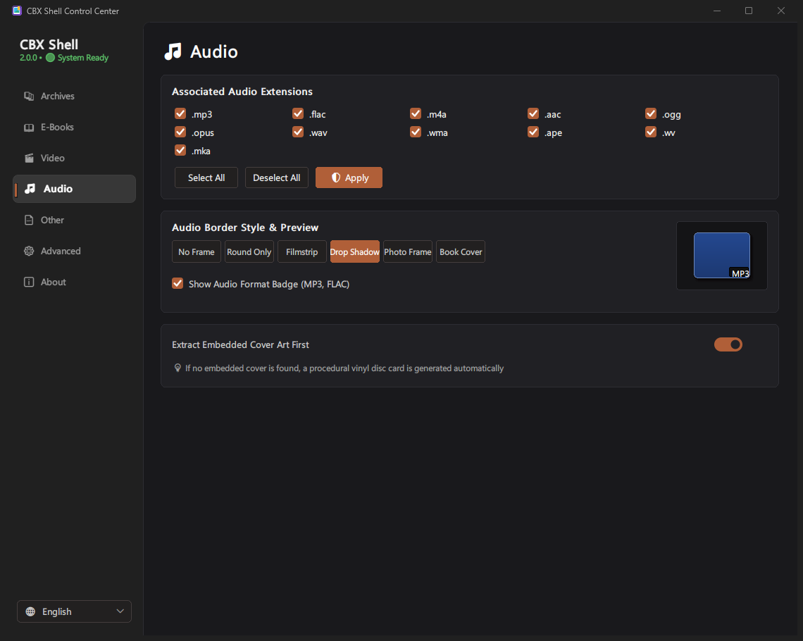 |

| Other | Advanced |
| :---: | :---: |
| 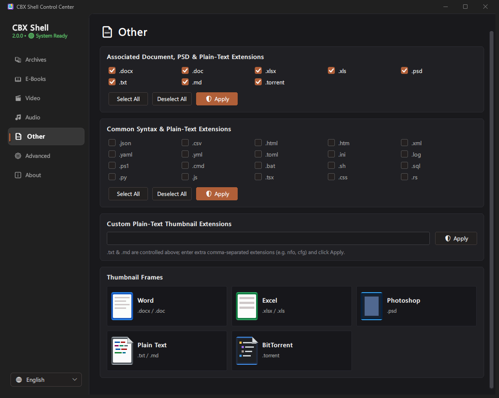 | 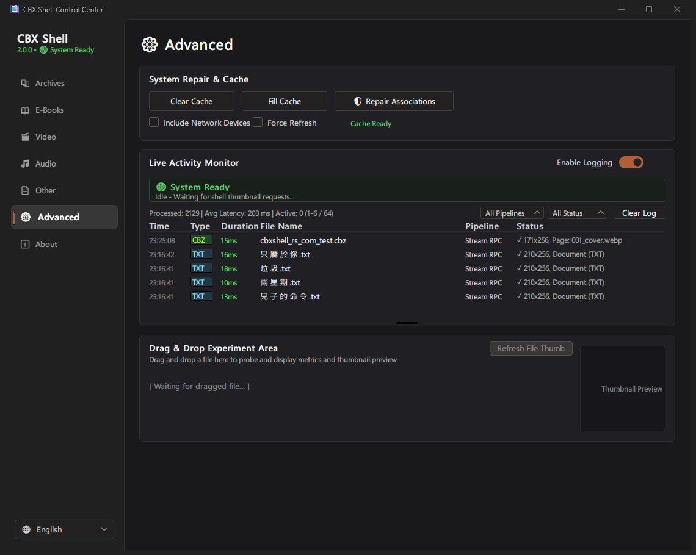 |

### Build, Package & Deploy
```powershell
# Build release binaries
cargo build --release --workspace

# Run tests, build, and package dist\CBXShell-Setup.exe
powershell -ExecutionPolicy Bypass -File .\build.ps1

# Deploy locally and register COM DLL
powershell -ExecutionPolicy Bypass -File .\deploy.ps1
```

### License & Acknowledgements
- **License**: Distributed under the **GNU General Public License v3.0 or later (`GPL-3.0-or-later`)**. See [LICENSE](./LICENSE) for details.
- **Original CBX Shell**: Inspired by the classic C++/ATL **CBXShell** project (originally published under CPOL 1.02). `cbxshell-rs` is a clean-room rewrite in Rust featuring memory-safe archive/document decoders, zero-trust security boundaries, and a modern Windows 11 Control Center.
- **BabelSoft Media Preview**: Smart video frame selection principles (seek positioning, Rec.601 luminance bounds, and Shannon entropy scoring) reference the evaluation methodology of **BabelSoft Media Preview**, re-implemented in Rust using Windows Media Foundation (`Direct3D 11` / `DXVA`) and FFmpeg fallback. CBX Shell Control Center also includes built-in detection for co-installed Media Preview shell handlers to help avoid thumbnail handler conflicts.

---

<a name="繁體中文說明"></a>
## 繁體中文說明


Windows 檔案總管多媒體與圖檔封裝縮圖擴充套件，採用 Rust 語言開發，提供圖檔壓縮包、電子書、影片、音訊、Office／PSD 文件與純文字／語法檔案之縮圖產生與檔案屬性提示。

### 專題技術文件目錄 (`doc/`)
詳細之實作規格、安全規則與演算法細節，請參閱模組化文件：

- 🏛️ **[架構設計與解碼管線 (`doc/architecture.zh-TW.md`)](./doc/architecture.zh-TW.md)**：雙層處理序隔離（`dllhost.exe` COM 代理與原生直通）、COM RPC 匿名串流路徑探測與 Everything IPC 查詢、Windows Media Foundation (Direct3D 11 / DXVA) 與 FFmpeg 解碼管線。
- 🛡️ **[零信任輸入驗證與隔離規則 (`doc/security.zh-TW.md`)](./doc/security.zh-TW.md)**：壓縮檔資源上限保護（Zip Bomb / Solid Bomb 記憶體預算）、安全告警角標與可選規則、設定檔防篡改與解碼器跨處理序隔離。
- 📚 **[壓縮檔與圖檔封裝支援 (`doc/archives.zh-TW.md`)](./doc/archives.zh-TW.md)**：支援容器（ZIP、RAR4/RAR5、7z、TAR）、CJK 多語系編碼辨識（Shift-JIS、Big5、GBK）、自然排序與連續檔名首張選取、長條圖檔自動裁切與 6 種外框樣式。
- 📖 **[電子書封面擷取支援 (`doc/ebooks.zh-TW.md`)](./doc/ebooks.zh-TW.md)**：EPUB、IBA、MOBI、AZW 與可選 PDF 封面解析及書籍封面樣式。
- 🎬 **[影片影格評定與縮圖產生 (`doc/video.zh-TW.md`)](./doc/video.zh-TW.md)**：定位模式與自訂演算法參數（跳步間隔、`max_gop_hops` 防回彈、探測上限）、Rec.601 亮度與 Shannon 圖像熵加權評分、HDR ACES 色調映射（預設啟用）與 Watchdog 逾時上限。
- 📄 **[文件、語法預覽與隨附工具 (`doc/other.zh-TW.md`)](./doc/other.zh-TW.md)**：Office／PSD 縮圖、20 種語法上色純文字預覽、`cbx-manager.exe`、`cbx-installer.exe` 與 `cbx-cli.exe` 指令說明。

### 支援格式一覽
- **圖檔封裝與壓縮檔**：`.cbz`, `.zip`, `.cbr`, `.rar`, `.cb7`, `.7z`, `.cbt`, `.tar`
- **電子書格式**：`.epub`, `.mobi`, `.iba`, `.azw`, `.pdf`（可選，預設關閉）
- **封裝內支援圖檔**：`JPEG`, `PNG`, `WebP`（靜態與動態）, `GIF`, `APNG`, `JPEG XL` (`.jxl`), `QOI`, `BMP`, `ICO`, `TIFF`, `DDS`, `TGA`, `PNM`（`.pbm`/`.pgm`/`.ppm`/`.pam`）, `Farbfeld` (`.ff`), `Radiance HDR` (`.hdr`), `OpenEXR` (`.exr`)
- **影片格式**：`.mp4`, `.m4v`, `.mkv`, `.webm`, `.avi`, `.mov`, `.wmv`, `.flv`, `.ts`, `.m2ts`, `.3gp`, `.ogv`, `.divx`, `.xvid`, `.mpg`, `.mpeg`（H.264 由 Media Foundation 解碼；HEVC/H.265、VP9、AV1 需安裝 Microsoft Store 影片延伸模組；ProRes 等其他編碼由可選的 FFmpeg 回退處理）
- **音訊格式**：`.mp3`, `.flac`, `.m4a`, `.aac`, `.ogg`, `.opus`, `.wav`, `.wma`, `.ape`（內嵌專輯封面讀取與黑膠唱片卡片回退）
- **文件、設計檔與純文字**：`.docx`, `.doc`, `.xlsx`, `.xls`, `.psd`, `.txt`, `.md`, `.torrent`，以及 20 種可選語法上色格式（`.json`, `.csv`, `.html`, `.htm`, `.xml`, `.yaml`, `.yml`, `.toml`, `.ini`, `.log`, `.ps1`, `.cmd`, `.bat`, `.sh`, `.sql`, `.py`, `.js`, `.tsx`, `.css`, `.rs`）與自訂純文字副檔名。

### 安裝說明
1. 從 Releases 下載 `CBXShell-Setup.exe`（或於本機執行 `.\build.ps1` 自行打包）。
2. 執行 `CBXShell-Setup.exe`，安裝程式會自動部署 `cbxshell.dll`、`cbx-manager.exe` 與 `cbx-cli.exe`，完成 COM 縮圖與屬性提示套件註冊，並套用預設副檔名關聯。
3. 依畫面提示重啟 Windows 檔案總管（`explorer.exe`）或重新登入，以載入新註冊的 Shell 擴充套件。
4. 可隨時從開始功能表或安裝目錄開啟 **CBX Shell 控制中心**（`cbx-manager.exe`），調整關聯副檔名、縮圖外框樣式、影片解碼模式與快取管理。

### 控制中心設定頁面
| 壓縮檔 | 電子書 |
| :---: | :---: |
| 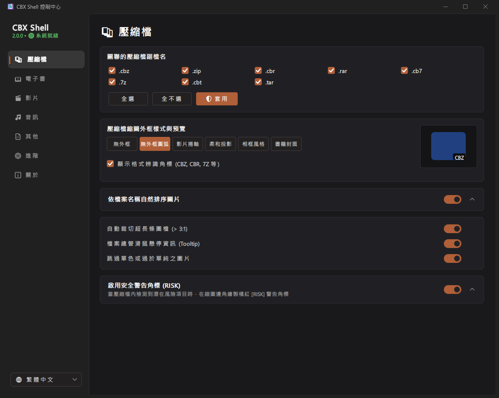 | 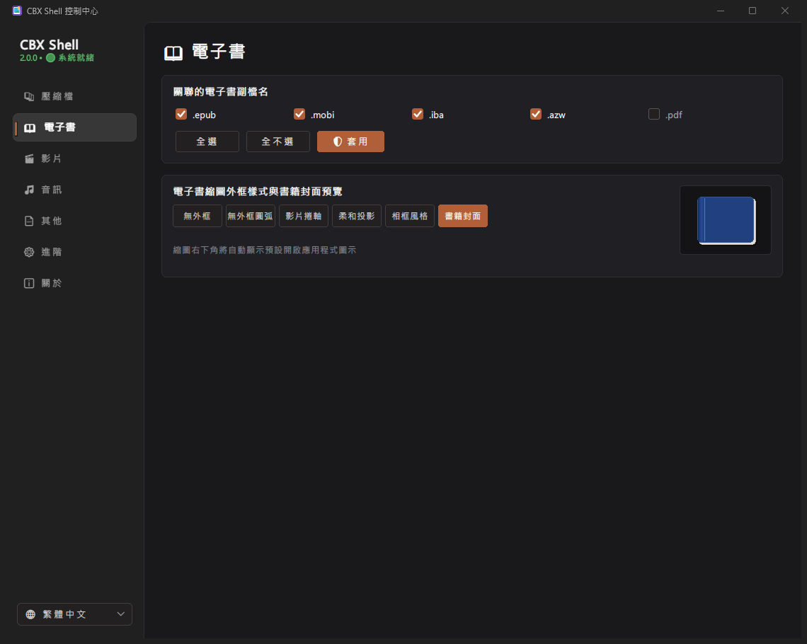 |

| 影片 | 音訊 |
| :---: | :---: |
| 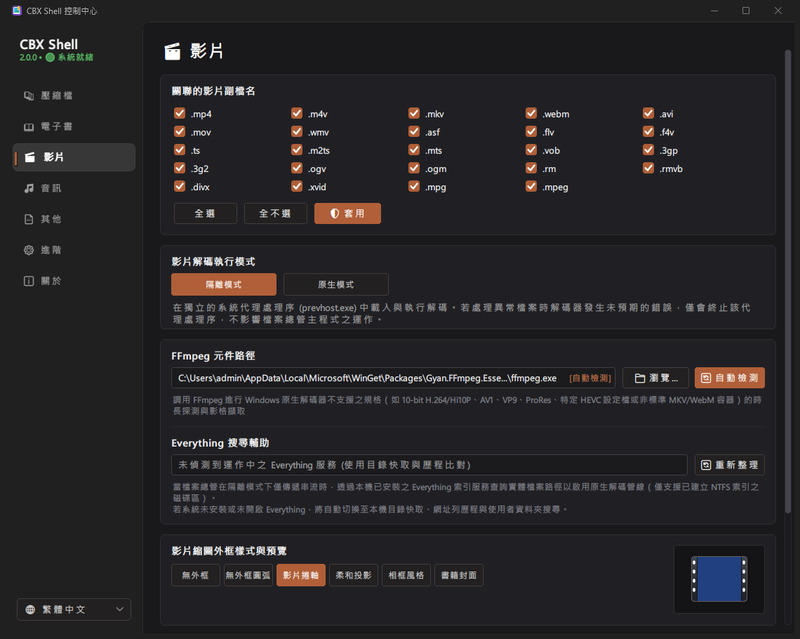 | 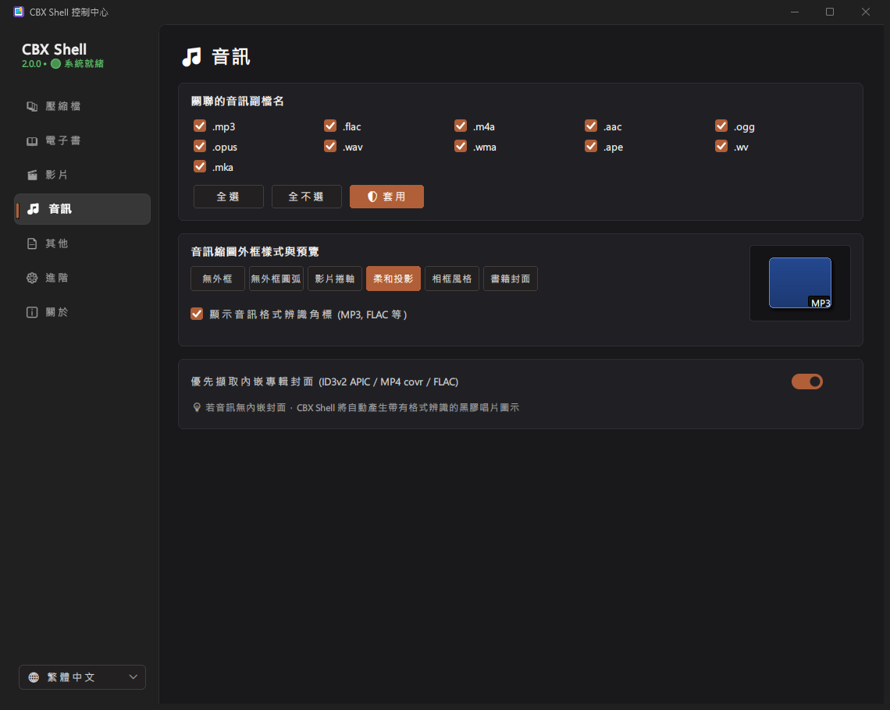 |

| 其他 | 進階 |
| :---: | :---: |
| 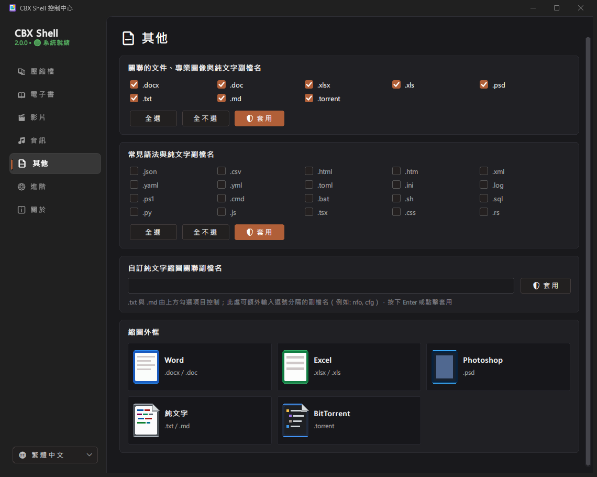 | 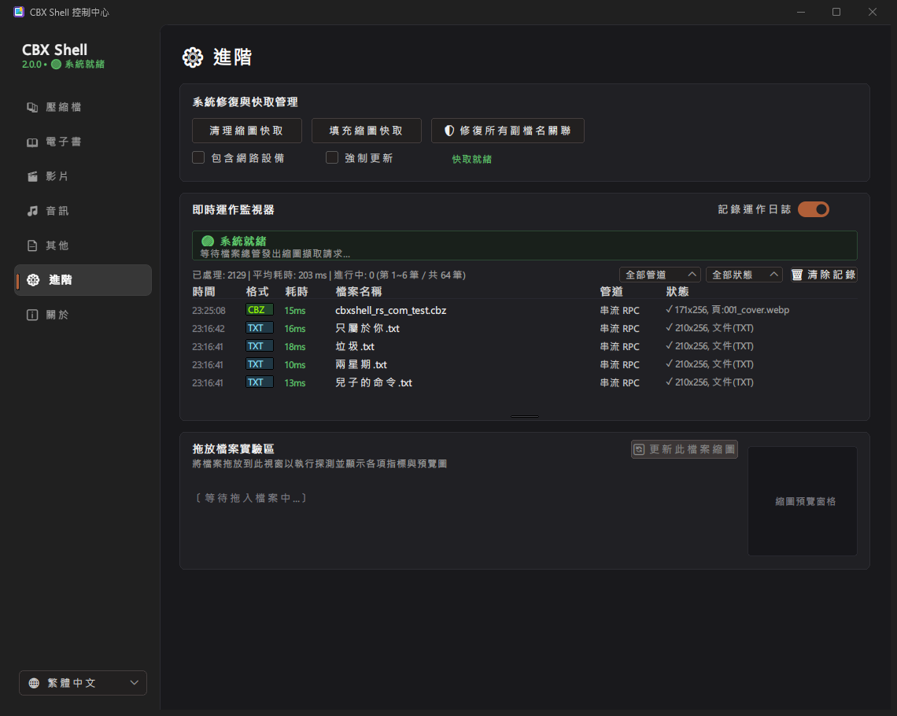 |

### 建置、打包與部署
```powershell
# 編譯 Release 版本
cargo build --release --workspace

# 執行測試、編譯並打包 dist\CBXShell-Setup.exe
powershell -ExecutionPolicy Bypass -File .\build.ps1

# 本機部署並註冊 COM DLL
powershell -ExecutionPolicy Bypass -File .\deploy.ps1
```

### 授權條款與設計致謝
- **授權條款**：本專案採用 **GNU General Public License v3.0 or later (`GPL-3.0-or-later`)** 授權釋出，詳細條文請參閱 [LICENSE](./LICENSE)。
- **原版 CBX Shell**：本專案靈感源自經典的 C++/ATL 開源漫畫縮圖擴充套件 **CBXShell**（原版採用 CPOL 1.02 授權），並以記憶體安全的 **Rust** 語言全面重構，加入零信任防禦邊界、現代化 Windows 11 控制中心與跨格式多媒體支援。
- **BabelSoft Media Preview**：影片智慧選影格演算法（定位取樣位置、Rec.601 亮度區間門檻與 Shannon 圖像熵評分）參考 **BabelSoft Media Preview** 之影格評估原理，並以 Rust 結合 Windows Media Foundation（`Direct3D 11` / `DXVA`）及 FFmpeg 回退管線重新實作；控制中心「關於」頁面亦內建 Media Preview 共存偵測，避免檔案總管縮圖處理常式衝突。