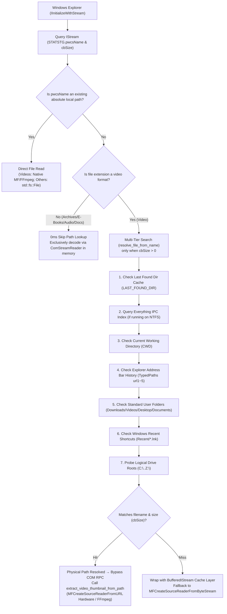
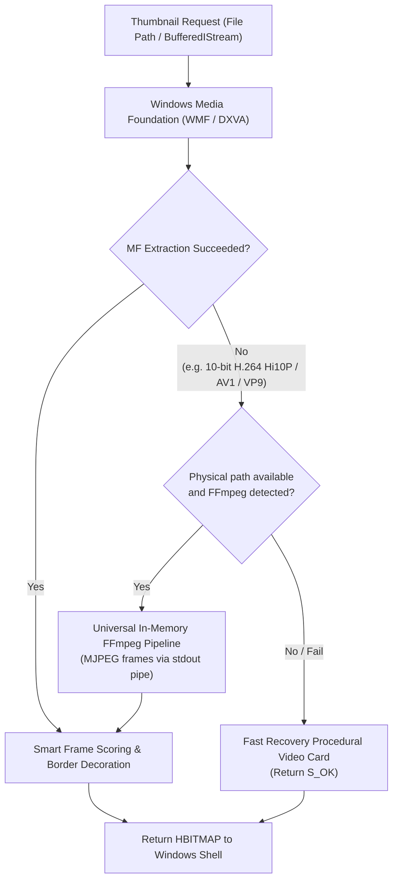

# Architecture & Decoding Pipeline

CBX Shell is a high-performance, robust Windows Shell thumbnail extension implemented in Rust, providing seamless preview generation for comic book archives, media videos, and audio files.

---

## 1. Dual-Tier Process Execution Modes

To ensure Windows Explorer (`explorer.exe`) system stability and process isolation, CBX Shell supports two execution modes:

- **Isolation Mode (Default)**:
  Thumbnail generation executes inside the Windows COM surrogate process (`dllhost.exe`, "COM Surrogate"): Windows isolates `IInitializeWithStream` thumbnail handlers there by default, and CBX Shell additionally registers an AppID `DllSurrogate` with `DisableProcessIsolation = 0`. If an abnormal or corrupted media file crashes the underlying codec parser, only the surrogate process terminates, leaving Windows Explorer unaffected.
- **Native Mode**:
  Sets `DisableProcessIsolation = 1` and runs directly in-process within `explorer.exe`, bypassing cross-process IPC for minimal latency; a decoder crash then takes Explorer down with it, so use it only for trusted files.

> [!NOTE]
> **Windows Explorer Restart**: Windows Explorer caches COM thumbnail provider instances once loaded. Toggling between Isolation Mode and Native Mode requires restarting `explorer.exe` (via Task Manager or user re-login) to flush COM Class Factory caches.

---

## 2. Anonymous COM Stream Handling & Stream-to-Path Resolution

When Windows Shell requests thumbnail generation, it typically supplies an anonymous COM stream (`IStream`) via `IInitializeWithStream` rather than a filesystem path for out-of-process sandbox isolation. CBX Shell intentionally splits how it handles streams depending on the media type:

### Why Non-Video Files Exclusively Use the Anonymous COM Stream While Videos Resolve a Physical Path

| Category | Handling Strategy | Architectural Rationale |
| :--- | :--- | :--- |
| **Archives / E-Books / Audio / Docs** | **Exclusively use `IStream`** (`ComStreamReader`, skipping path lookup) | These formats require no GPU or hardware video decoder—they only read container headers and extract a single cover image. Skipping disk path resolution during `IInitializeWithStream::Initialize` achieves an **instant 0ms handshake** and avoids unnecessary disk I/O; decoding reads directly in memory via `ComStreamReader` (`Read + Seek`). *(A file is opened directly only if `STATSTG.pwcsName` is an **absolute path on a local drive**, or the path came from `IInitializeWithFile` / `IInitializeWithItem`. A bare or relative name is used purely as an extension hint and is never resolved against the host process's working directory.)* |
| **Video Files** (`.mp4`, `.mkv`, etc.) | **Actively resolve physical path** (falling back to `BufferedIStream` only on miss) | Video files are large and container index tables (e.g., MP4 `moov`, MKV `Cues`) require hundreds of random `Seek` calls. Performing those seeks over cross-process COM RPC accumulates IPC latency and risks Explorer watchdog timeouts. Moreover, having the physical file path bypasses COM RPC completely and unlocks **Media Foundation (`MFCreateSourceReaderFromURL`) Direct3D 11 / DXVA hardware acceleration** and **native FFmpeg file decoding**. |

### Post-Resolution Execution Pipeline for Videos
1. **7-Tier Path Reverse-Lookup (`resolve_file_from_name`)**:
   - Extracts filename from `STATSTG.pwcsName` and file size `cbSize` (rejecting UNC network and device paths).
   - Runs only when `cbSize` is known (non-zero); every candidate must match it exactly, and TypedPaths / `.lnk` / cached directories are followed only on local fixed or removable drives (see [`security.md` §6](./security.md)).
   - Probes in order: **1. `LAST_FOUND_DIR` cache** → **2. Everything IPC NTFS index** → **3. Working directory (CWD)** → **4. Explorer `TypedPaths` (`url1~5`)** → **5. Standard user folders (`Downloads`, `Videos`, `Desktop`, `Documents`)** → **6. Windows `Recent/*.lnk` shortcuts** → **7. Logical drive roots**.
2. **Switch to Zero-RPC Native Decoding**:
   - Once filename and exact `cbSize` match, CBX Shell stores the resolved `file_path` and tags the pipeline source (e.g., `IPC Hit`, `Search Hit`).
   - On the background worker thread, the video branch discards the COM `IStream` and passes the native path directly to `extract_video_thumbnail_from_path`, invoking `MFCreateSourceReaderFromURL` (DXVA hardware acceleration) or FFmpeg for keyframe extraction and smart frame scoring (luminance + Shannon entropy).
3. **Prefetch Cache Fallback on Miss (`BufferedIStream`)**:
   - If all 7 tiers miss (or `cbSize` is unknown), CBX Shell wraps the COM `IStream` in a 512 KiB-chunk read-ahead cache (`BufferedIStream`), greatly reducing cross-process RPC round-trips, and falls back to `MFCreateSourceReaderFromByteStream`. This stream-only path has no file to hand to FFmpeg, so only Media Foundation is used.

---

## 3. Tiered Media & Video Decoding Pipeline

CBX Shell implements a multi-tier fallback pipeline ensuring hardware acceleration for standard codecs and broad compatibility for specialized formats:

1. **Tier 1: Windows Media Foundation (WMF / DXVA)**:
   Direct3D 11 hardware acceleration decodes standard formats such as H.264; HEVC, AV1 and VP9 require the corresponding Microsoft Store video extensions.
2. **Tier 2: Universal In-Memory FFmpeg Fallback**:
   - When Media Foundation fails (e.g. 10-bit H.264 Hi10P, unusual MKV/WebM containers, ProRes) and a physical path is available, decoding shifts to `ffmpeg.exe`, which runs inside a restricted sandbox (see [`security.md` §4–5](./security.md)).
   - Encoded candidate frames (MJPEG via `image2pipe`) are ingested into memory directly via **stdout pipe streams**, writing zero temporary files to disk.
3. **Tier 3: Fast Recovery Safe Procedural Cards**:
   If decoding fails or files are damaged, the provider returns `S_OK` with a clean procedural format card instead of `E_FAIL` (which prompts Windows Explorer to stall for 30 seconds polling legacy DirectShow decoders).
