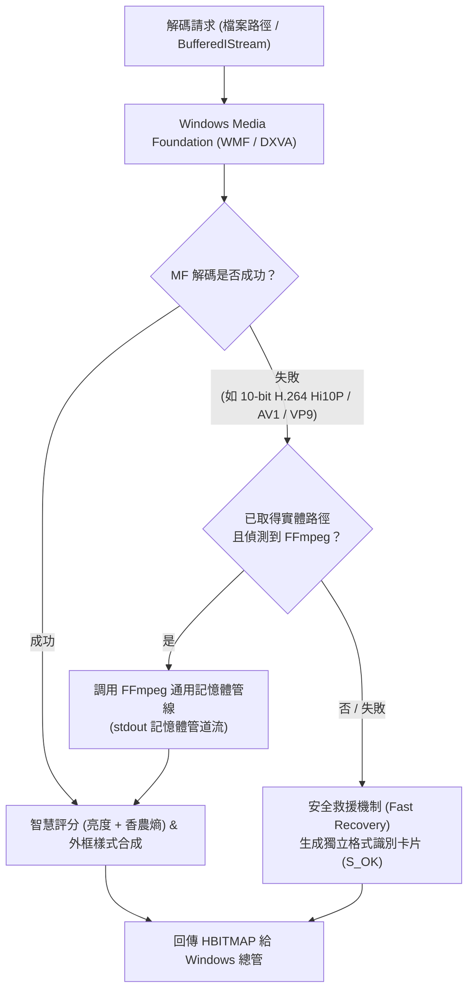

# 架構設計與解碼管線 (Architecture & Pipeline)

本專案採用 Rust 撰寫 Windows Shell 縮圖擴充套件（CBX Shell），提供圖檔封裝壓縮檔、多媒體影片與音訊的高效、安全縮圖預覽功能。

---

## 1. 雙層處理序隔離架構 (Execution Modes)

為了確保 Windows 檔案總管（`explorer.exe`）的穩定度與系統安全性，系統提供兩種執行架構：

- **隔離模式（Isolation Mode，預設）**：
  縮圖產生作業於 Windows 的 COM 代理處理序（`dllhost.exe`，即「COM Surrogate」）中執行：Windows 預設即以此隔離 `IInitializeWithStream` 縮圖處理常式，CBX Shell 另以 AppID `DllSurrogate` 註冊同一機制，並將 `DisableProcessIsolation` 設為 `0`。當遇到異常或毀損的媒體檔案導致底層解碼器中止時，僅會結束該代理行程，不影響檔案總管主程式。
- **原生模式（Native Mode）**：
  設定 `DisableProcessIsolation = 1`，直接載入於 `explorer.exe` 行程內運作，省去跨行程 IPC 開銷、延遲最低；但解碼器若崩潰會連帶影響檔案總管，僅建議在信任檔案來源時使用。

> [!NOTE]
> **重啟檔案總管機制**：Windows Explorer 在初次調用特定副檔名之 COM 縮圖物件後，會將其 Class Factory 與物件實例快取在進程記憶體中。切換「隔離模式」或「原生模式」後，需重啟 `explorer.exe`（可透過工作管理員或重新登入）方可全面釋放舊快取並套用新模式。

---

## 2. 匿名 COM 串流解析與原生路徑探測機制 (Stream-to-Path Resolution)

當 Windows Shell 請求產生縮圖時，出於沙盒隔離與跨行程安全考量，通常透過 `IInitializeWithStream` 提供匿名 COM 串流（`IStream`），而不直接給予檔案系統路徑。針對不同媒體類型，CBX Shell 採取**刻意分流**的架構設計：

### 為何壓縮檔等非影片格式優先且唯一使用匿名 COM 串流，而影片檔卻須探測實體路徑？

| 類型 | 處理策略 | 核心原因 |
| :--- | :--- | :--- |
| **壓縮檔 / 電子書 / 音訊 / 文件** | **優先且唯一使用 `IStream`**（`ComStreamReader`，跳過路徑探測） | 這些格式無需 GPU / 硬體解碼器，僅須讀取標頭索引與單一封面圖檔即可完成解碼。直接在 `IInitializeWithStream::Initialize` 跳過磁碟探測可達到 **0ms 握手**，並避免額外的硬碟 I/O 與索引查詢；解碼時由 `ComStreamReader` 透過 `Read + Seek` 在記憶體內直接串流解析。（註：僅當 `STATSTG.pwcsName` 為**本機磁碟的絕對路徑**，或路徑由 `IInitializeWithFile`／`IInitializeWithItem` 提供時，才會直接開啟檔案；單純檔名或相對名稱一律只作為副檔名提示，絕不以宿主行程的工作目錄解析。） |
| **影片檔**（`.mp4`、`.mkv` 等） | **主動反查實體路徑**（失敗才回退 `BufferedIStream`） | 影片檔體積龐大且容器索引表（如 MP4 `moov`、MKV `Cues`）需要高頻率隨機 `Seek`；若透過跨行程 COM RPC 串流傳輸，數百次跨行程往返容易累積延遲並觸發逾時保護。此外，取得實體路徑後才能徹底繞過 COM RPC，啟用 **Media Foundation (`MFCreateSourceReaderFromURL`) Direct3D 11 / DXVA 硬體加速** 與 **FFmpeg 原生檔案解碼**。 |

### 取得影片實體路徑後的執行機制
1. **7 層路徑反查搜尋（`resolve_file_from_name`）**：
   - 提取 `STATSTG.pwcsName` 檔名與 `cbSize` 檔案大小（拒絕 UNC 網路路徑與裝置路徑）；
   - 僅在 `cbSize` 已知（非 0）時執行；所有候選檔大小須完全相符，且 TypedPaths／`.lnk`／快取目錄只在本機固定或卸除式磁碟上追蹤（詳見 [`security.zh-TW.md` §6](./security.zh-TW.md)）；
   - 依序探測 **1. 最後命中目錄快取（`LAST_FOUND_DIR`）** → **2. Everything IPC 全磁碟索引** → **3. 目前工作目錄（CWD）** → **4. 總管網址列歷史（`TypedPaths` url1~5）** → **5. 標準使用者目錄（Downloads、Videos、Desktop、Documents）** → **6. Windows 最近開啟捷徑（`Recent/*.lnk`）** → **7. 邏輯磁碟根目錄**。
   - **本機優先**：同一個檔案常同時存在於本機磁碟與 NAS（檔名、大小都相同）。Everything 的多筆結果會先驗證本機磁碟、再驗證網路共用與網路磁碟機（同組內以上次命中目錄優先）；若最後命中目錄快取是網路位置，則延到 Everything 之後才嘗試，避免瀏覽過 NAS 後連本機縮圖都走網路。
2. **切換至零 RPC 原生解碼管線**：
   - 一旦檔名與 `cbSize` 位元組大小精確吻合，立即寫入 `file_path` 並記錄命中來源（如 `IPC Hit`、`Search Hit`）；
   - 進入背景解碼執行緒後，影片分支不再讀取原本的 COM `IStream`，而是直接將實體路徑交由 `extract_video_thumbnail_from_path` 調用 `MFCreateSourceReaderFromURL`（DXVA 硬體加速）或 FFmpeg 進行關鍵影格取樣與智慧評分（亮度 + 香農熵）。
3. **未命中時的預讀快取回退（`BufferedIStream`）**：
   - 若 7 層搜尋全數未命中（或 `cbSize` 未知），改以 512 KiB 區塊預讀快取包裝 COM `IStream`（`BufferedIStream`），大幅減少跨行程 RPC 往返後，回退至 `MFCreateSourceReaderFromByteStream` 完成解碼。此串流路徑沒有實體檔案可交給 FFmpeg，因此僅使用 Media Foundation。

---

## 3. 多媒體與影片解碼雙管線架構

系統採用階層式解碼架構，兼顧主流格式硬體加速與罕見格式相容性：

1. **第一線：Windows Media Foundation (WMF / DXVA)**：
   優先調用系統 Direct3D 11 硬體加速解碼器解碼 H.264 等標準格式；HEVC、AV1、VP9 需安裝對應的 Microsoft Store 影片延伸模組。
2. **第二線：FFmpeg 通用記憶體管線回退（Universal Fallback）**：
   - 當 Media Foundation 解碼失敗（如 10-bit H.264 Hi10P 等 WMF 不支援之編碼），且已取得影片實體路徑、系統已安裝 FFmpeg 或設定自訂路徑時，切換至外部解碼器執行影格提取；FFmpeg 以受限沙盒執行（詳見 [`security.zh-TW.md` §4–5](./security.zh-TW.md)）。
   - 縮圖影格（透過 `image2pipe` 輸出之 MJPEG 串流）經由 stdout 管道流直接載入記憶體，**全程無磁碟暫存寫入**，兼顧隱私與磁碟壽命。
3. **終端防護：安全救援機制（Fast Recovery）**：
   若直接開啟的本機檔案損毀或解碼失敗，不回傳 `E_FAIL`，改由記憶體生成帶格式角標之影片樣式卡片並回傳 `S_OK`，避免觸發 Windows 總管舊版 DirectShow 30 秒輪詢阻塞。只能透過串流取得的檔案（網路／UNC 共用資料夾）失敗或逾時時改回傳 `WTS_E_FAILEDEXTRACTION`／`WTS_E_EXTRACTIONTIMEDOUT`，避免檔案總管快取失敗卡片。
