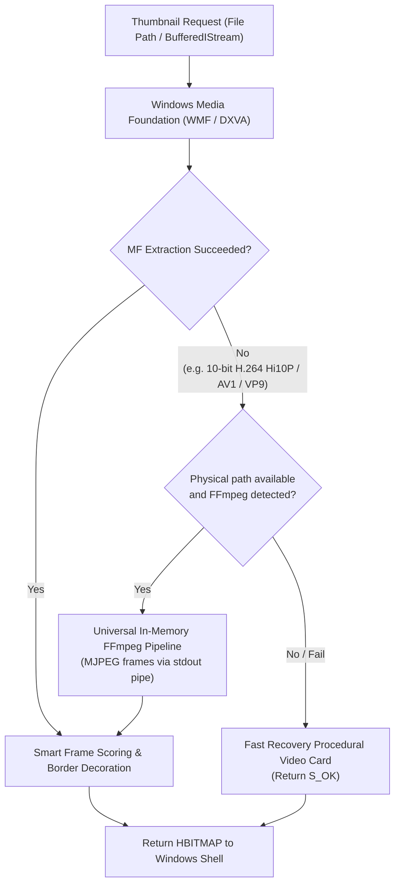

# Video Frame Evaluation & Thumbnail Generation

CBX Shell integrates an intelligent frame evaluation engine combining native Windows Media Foundation hardware acceleration with a universal in-memory FFmpeg fallback pipeline. Guided by objective multimedia quality indicators and Shannon entropy metrics, thumbnails are representative, sharp, and non-blocking.

---

## 1. Frame Seek Strategies & Custom Algorithm Parameters

Users can select among three seek modes (`seek_mode`) and customize probing parameters via `SmartRenderConfig` in the Control Center:

- **Seek Modes**:
  - **Duration Percentage (`seek_mode = 0`)**: Targets a percentage into the video duration (`position_seek_percent`, default `25%`) to skip intro cards.
  - **Fixed Offset (`seek_mode = 1`)**: Starts evaluation after a fixed number of seconds (`seek_fixed_sec`, default `120s`), suitable for episodic content.
  - **Smart Duration (`seek_mode = 2`, default)**: Uses percentage seek (`position_seek_percent`) for shorter clips, and switches to fixed offset (`seek_fixed_sec`) when duration exceeds `seek_threshold_min` (default `60 min`).
- **Probing & Anti-Snapback Parameters**:
  - **Step Probe Interval (`step_probe_sec`, default `6s`)**: Forward step size when a candidate frame does not meet quality thresholds.
  - **Keyframe Probe Limit (`consecutive_unacceptable_limit`, default `6`)**: Maximum number of candidate frames inspected before accepting the highest-scoring frame.
  - **Cross-GOP Snapback Guard (`max_gop_hops`, default `8`, `0` = disabled)**: Maximum forward GOP hops to prevent decoder keyframe seeking from snapping back to an already-rejected keyframe.

---

## 2. Frame Quality Evaluation & Scoring Algorithm

Candidate frames are evaluated with single-pass zero-allocation sampling (`NV12` Y-plane, `BGRA`, or `YUY2`; up to 16,384 pixels during probing, 65,536 pixels for full scoring):

1. **Mean Luminance (`luminance_enabled`, default `true`)**:
   - Computes Rec.601 perceived luminance `Y = (77*R + 150*G + 29*B) >> 8` as `0%..100%`.
   - Default acceptable range: `40%..80%` (`luminance_lower_limit` .. `luminance_upper_limit`).
2. **Normalized Shannon Entropy (`entropy_enabled`, default `true`)**:
   - Computes 256-bin histogram Shannon entropy normalized by 8.0 bits (`0%..100%`).
   - Default minimum threshold: `20%` (`entropy_lower_limit`), filtering flat or single-color frames.
3. **Weighted Scoring (`evaluate_metrics`) & Early Stopping**:
   - Computes `score = entropy_percent - penalty`.
   - Applies penalties for out-of-range luminance, severe black screens (`lum < 15%` and `ent < 35%`, `+35`), white/flash transitions (`lum > 88%` and `ent < 35%`, `+40`), flat bright skies (`lum > 62%` and `ent < 45%`, `+35`), muddy dark scenes (`lum < 24%` and `ent < 45%`, `+35`), and low-entropy flat tones (`ent < 25%`).
   - If a candidate passes both thresholds, probing stops immediately; otherwise, once `consecutive_unacceptable_limit` or the time budget is reached, the candidate with the highest `score` is selected.

---

## 3. Universal In-Memory FFmpeg Fallback Pipeline

> For details on how COM `IStream` inputs are resolved to physical paths (`resolve_file_from_name`) or wrapped in `BufferedIStream`, see [System Architecture & Pipeline](./architecture.md#2-anonymous-com-stream-handling--stream-to-path-resolution).

When Media Foundation encounters codecs unsupported by native Windows decoders, CBX Shell triggers the universal fallback pipeline (only when a physical file path is available; a bare `IStream` cannot be handed to FFmpeg):

1. **Trigger Scenarios**:
   - 10-bit H.264 (Hi10P), specialized HEVC profiles, non-standard MKV/WebM containers, ProRes, VP9, or unreadable streams.
2. **Zero-Disk-I/O Streaming Pipeline**:
   - Detects `ffmpeg.exe`: the custom path set in the Control Center first; otherwise the host process directory, registry `InstallLocation` (`HKCU/HKLM`), `%LOCALAPPDATA%\Programs\CBXShell` (and `bin`), WinGet links, `%ProgramFiles%\CBXShell` (and `bin`), and the system PATH (skipping relative, UNC, `Temp` and `Downloads` entries).
   - Emits MJPEG frames through `image2pipe`; they are read from the **stdout pipe** straight into memory and decoded under strict limits, writing zero temporary files to disk.
   - Evaluates luminance and Shannon entropy on candidate frames with progressive stepping.
   - Runs confined: local-file protocol only, container (`-format_whitelist`) and decoder (`-codec_whitelist`) allowlists, video stream only (`-an -sn -dn`), started suspended inside a restrictive Job Object. Files using a codec outside the allowlist fall back to the procedural card (see [`security.md` §4–5](./security.md)).
3. **Fast Recovery Fallback**:
   - If files are corrupted or FFmpeg is missing, the engine returns `S_OK` with a procedural video badge card instead of `E_FAIL` (which causes Windows Explorer to stall for up to 30 seconds polling legacy DirectShow decoders), ensuring responsive shell browsing.

---

## 4. HDR ACES Filmic Tone-Mapping

- **Core Mechanism**:
  Windows Explorer thumbnail cache strictly enforces standard **8-bit sRGB (SDR)** bitmaps; Windows does not maintain HDR thumbnail caches.
  For videos with HDR (HDR10 / BT.2020 PQ / HLG) metadata, ACES tone-mapping compresses high-dynamic-range luminance into standard sRGB space, **preventing washed-out, milky, or low-contrast thumbnails**.
- **Automatic HDR Detection & SDR Pass-Through** (enabled by default):
  - **Native Pipeline**: Inspects Media Foundation stream attributes for `MF_MT_TRANSFER_FUNCTION` (7=ST.2084 PQ, 8=HLG), `MF_MT_VIDEO_PRIMARIES` (3=BT.2020), and `MF_MT_SUBTYPE` (P010/P016 10-bit YUV);
  - **FFmpeg Pipeline**: Automatically probes stream color metadata for `bt2020`, `smpte2084`, `arib-std-b67`, and `Mastering Display` tags;
  - **SDR Pass-Through**: ACES tone-mapping is applied only when HDR metadata is detected. Standard dynamic range (SDR/Rec.709) videos pass through unaffected with original colors and contrast.

---

## 5. Performance & Watchdog Timeouts

- **Configurable Watchdog**: Timeout budget (default 12s, range 3s to 60s).
- **Diagnostics Recording**: Captures detailed stage, execution time, and resolution metrics in the Live Activity Monitor to facilitate troubleshooting.
