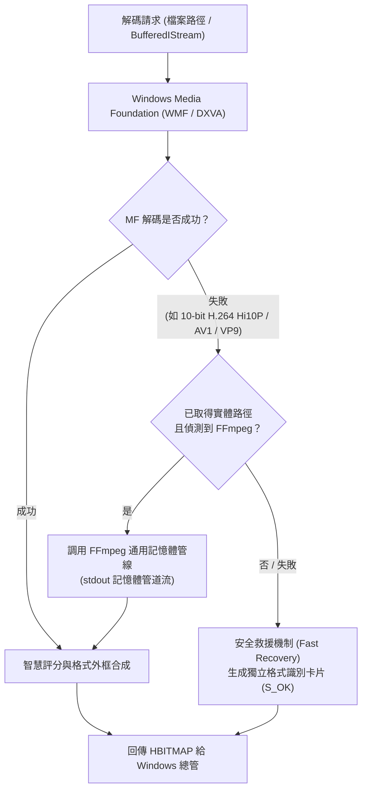

# 影片影格評定與縮圖產生 (Video & Media Processing)

CBX Shell 內建選影格演算法，結合 Windows Media Foundation 原生硬體加速與 FFmpeg 通用記憶體管線回退（Universal Fallback），並參考多媒體縮圖指標與 Shannon 圖像熵模型，產生具代表性的影片縮圖並避免系統阻塞。

---

## 1. 影格選取原則與自訂演算法參數 (Seek Strategy & Parameters)

使用者可在控制中心調整 `SmartRenderConfig` 相關參數，系統支援三種定位模式與進階探測參數：

- **定位模式（`seek_mode`）**：
  - **片長百分比（`seek_mode = 0`）**：跳至影片總長度的指定百分比處（`position_seek_percent`，預設 `25%`）進行影格探測，避開片頭畫面。
  - **固定秒數（`seek_mode = 1`）**：固定跳過前導秒數（`seek_fixed_sec`，預設 `120` 秒）後開始擷取，適合劇集或綜藝節目。
  - **智慧時長（`seek_mode = 2`，預設）**：短片依 `position_seek_percent` 定位；片長超過 `seek_threshold_min`（預設 `60` 分鐘）時切換為跳過 `seek_fixed_sec`。
- **探測與防回彈參數**：
  - **跳步探測間隔（`step_probe_sec`，預設 `6` 秒）**：當候選影格未達品質門檻時向前推進的秒數。
  - **關鍵影格探測上限（`consecutive_unacceptable_limit`，預設 `6` 次）**：最多嘗試探測的影格數上限，達上限後採用最高評分候選幀。
  - **跨 GOP 防回彈推進上限（`max_gop_hops`，預設 `8` 次，`0` 為停用）**：防止解碼器 Seek 至鄰近關鍵影格時回彈到已判定不合格的同一 GOP 影格。

---

## 2. 影格品質評估與加權評分演算法 (Evaluation & Scoring)

候選影格採用零配置單次掃描取樣（支援 `NV12` Y 平面、`BGRA` 與 `YUY2`；探測階段最多取樣 16,384 像素，完整評估取樣 65,536 像素）：

1. **平均亮度過濾（`luminance_enabled`，預設開啟）**：
   - 使用 Rec.601 近似公式 `Y = (77*R + 150*G + 29*B) >> 8` 計算 `0%～100%` 平均亮度。
   - 預設有效區間為 `40% ～ 80%`（`luminance_lower_limit` ～ `luminance_upper_limit`）。
2. **正規化 Shannon 圖像熵（`entropy_enabled`，預設開啟）**：
   - 統計 256 階灰階直方圖並以 8.0 bits 正規化為 `0%～100%`。
   - 預設最低門檻為 `20%`（`entropy_lower_limit`），過濾純色或單調背景。
3. **加權評分（`evaluate_metrics`）與早停機制**：
   - 依 `score = entropy_percent - penalty` 計算總分。
   - 針對超出亮度區間、極暗黑屏（`lum < 15%` 且 `ent < 35%` 扣 35 分）、過曝白屏（`lum > 88%` 且 `ent < 35%` 扣 40 分）、單調亮天空（`lum > 62%` 且 `ent < 45%` 扣 35 分）、低對比暗景（`lum < 24%` 且 `ent < 45%` 扣 35 分）與低熵純色（`ent < 25%`）進行扣分。
   - 任一候選影格同時通過亮度與熵門檻即刻採納並結束探測；若達探測次數或時間預算上限，則選取累計 `score` 最高之候選幀。

---

## 3. FFmpeg 通用記憶體管線回退 (Universal Fallback Pipeline)

> COM 匿名串流（`IStream`）如何透過 `resolve_file_from_name` 反查實體路徑或包裝為 `BufferedIStream`，請參閱 [架構設計與解碼管線](./architecture.zh-TW.md#2-匿名-com-串流解析與原生路徑探測機制-stream-to-path-resolution)。

當 Media Foundation 遇到 Windows 原生解碼器不支援之特殊規格時，系統自動啟動通用回退管線（僅限已取得影片實體路徑時；純 `IStream` 串流無法交給 FFmpeg）：

1. **觸發情境**：
   - 10-bit H.264 (Hi10P)、特殊 HEVC Profile、非標準 MKV/WebM 容器、ProRes、VP9 或 Windows 原生解碼器無法讀取的格式。
2. **零磁碟 I/O 之管道串流解碼**：
   - 偵測 FFmpeg：優先使用控制中心設定的自訂路徑；否則依序探測宿主程式所在目錄、註冊表 `InstallLocation`（`HKCU/HKLM`）、`%LOCALAPPDATA%\Programs\CBXShell`（含 `bin`）、WinGet Links、`%ProgramFiles%\CBXShell`（含 `bin`）與系統 PATH（略過相對路徑、UNC、`Temp` 與 `Downloads`）；
   - 以 `image2pipe` 輸出 MJPEG 影格，經標準輸出（stdout）管道直接載入記憶體並以嚴格上限解碼，**全程不寫入任何磁碟暫存檔**；
   - 於記憶體中同步執行平均亮度與香農熵度評分，若遇不合格影格則向前跳步探測，兼顧效能與影格代表性。
   - 受限執行：僅允許本機檔案協定、容器（`-format_whitelist`）與解碼器（`-codec_whitelist`）白名單、只處理影片串流（`-an -sn -dn`），並以暫停狀態啟動後綁定受限 Job Object。使用白名單外編碼的檔案會改以樣式卡片呈現（詳見 [`security.zh-TW.md` §4–5](./security.zh-TW.md)）。
3. **安全救援機制（Fast Recovery）**：
   - 若檔案毀損或未安裝 FFmpeg，系統不回傳 `E_FAIL`（避免觸發 Windows 總管舊版 DirectShow 30 秒輪詢阻塞）；
   - 而是於記憶體生成帶有格式識別角標的影片樣式卡片並回傳 `S_OK`，讓檔案總管立即完成更新（僅限已直接開啟本機檔案仍解碼失敗的情況）。
   - **串流的 FFmpeg 後援**：Media Foundation 無法從串流解碼時（FLV、許多 MKV 等），改由 FFmpeg 經標準輸入讀取（只允許 `pipe` 協定），並套用與檔案管線**相同的演算法參數**（影格選取原則、片長百分比、跳過前導秒數、長片切換門檻、跳步探測間距、關鍵影格探測上限、亮度／熵度評分、單檔時間上限、HDR 色調映射）：先餵入串流開頭 2 MiB 讀取片長與 HDR 資訊；再依「目標秒數 ÷ 片長 × 串流大小」估算位元組位置，餵入容器開頭加上該位置附近 12 MiB 的資料，由 FFmpeg 解多工器重新同步後取目標時間之後的第一張影格；目標接近開頭時則連續餵入並以輸出端 `-ss` 定位。全部候選都失敗時才退回第一張影格。
   - **例外：只能透過串流取得的檔案**（網路／UNC 共用資料夾、串流 RPC 管線）解碼失敗或逾時時，**不產生**樣式卡片，而是回傳 `WTS_E_FAILEDEXTRACTION`／`WTS_E_EXTRACTIONTIMEDOUT`。檔案總管會暫時顯示預設圖示且不快取結果；否則失敗卡片會被快取，蓋過之後成功產生的真正縮圖。

---

## 4. HDR ACES 色調映射 (HDR ACES Tone-Mapping)

- **核心機制**：
  Windows 檔案總管的縮圖緩存機制規範為 **標準 8-bit sRGB (SDR)**，Windows 本身不支援產出 HDR 規格縮圖。
  針對具備 HDR (HDR10 / BT.2020 PQ / HLG) 廣色域與高動態範圍之影片，色調映射（Tone-Mapping）透過 ACES Filmic 曲線將高動態範圍壓縮至 sRGB 空間，**防止 HDR 影片在檔案總管中呈現泛白、褪色與低對比**。
- **HDR 自動偵測與 SDR 直通（預設啟用）**：
  - **原生管線**：自動讀取 Media Foundation 媒體格式屬性中的 `MF_MT_TRANSFER_FUNCTION`（7=ST.2084 PQ, 8=HLG）、`MF_MT_VIDEO_PRIMARIES`（3=BT.2020）及 `MF_MT_SUBTYPE`（P010/P016 10-bit YUV）；
  - **FFmpeg 管線**：自動探測串流中繼資料中的 `bt2020`、`smpte2084`、`arib-std-b67`、`Mastering Display` 等色度標記；
  - **SDR 直通處理**：僅在檢測出影片具備 HDR 規格時才套用 ACES 色調映射；對於一般標準動態範圍（SDR/Rec.709）影片，系統直接輸出原始色彩與亮度，不影響一般影片顯示。

---

## 5. 效能與逾時防護 (Watchdog Timeout)

- **自訂逾時時間**：可在設定中自訂逾時上限（預設 12 秒，支援範圍 3～60 秒）。
- **除錯資訊記錄**：當發生耗時或逾時跳過時，即時運作監視器記錄處理階段、檔案路徑與耗時，方便進行問題定位。
